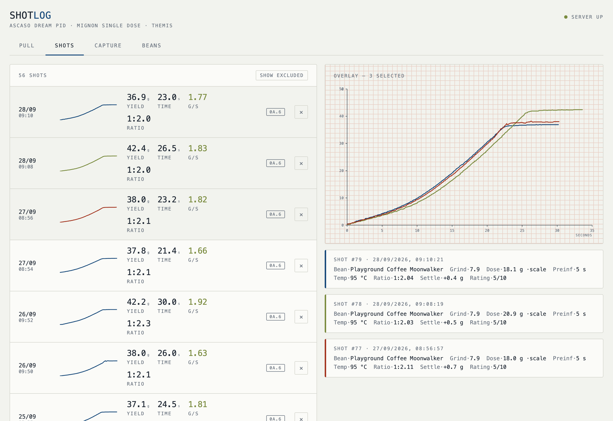

# espressolog

[](https://github.com/weatherhog/espressolog/actions/workflows/ci.yml)

Instrumentation for an **Ascaso Dream PID** espresso machine and a **Eureka
Mignon Single Dose** grinder. An ESP32-S3 reads two Bluetooth scales, detects
shots from the weight curve alone, spools them to flash, and uploads them to a
small Go service that stores them in SQLite and serves a PWA.



Currently **Phase 0: logging only**. Nothing actuates the machine — every
sense tap is high-impedance and read-only. That is a hard invariant, not a
stage we are waiting to leave.

From the perfboard onward the board also *carries* the Phase 1 actuation
parts, behind open jumpers that leave them unable to conduct. The invariant
is about what the hardware can do, not about what is soldered to it.
**`CLAUDE.md` hard invariant 1 is the normative text and this paragraph
deliberately does not paraphrase it** — earlier paraphrases here went stale
twice.

A visual tour is in [docs/overview.md](docs/overview.md).

## Two results worth reading even if you don't own this machine

**The front display bus is decoded.** The Ascaso's mainboard talks to its
display over a plain synchronous serial link — *not* I²C, whatever sigrok's
decoder claims when you point it at the same pins. ~9.9 kHz clock, data sampled
on the rising edge, and a **67-bit frame followed by a 66-bit frame** every
~41 ms — the 67 carries the button state, the 66 the digits, at known bit
offsets. (The two usually arrive glued together; a "133-bit frame" is that
merge artefact, not a frame, and a parser keyed on 133 bits throws away digit
readings exactly when the machine is working hardest.) Idle it carries boiler
temperature; during a brew it carries the
machine's own shot timer in tenths of a second. The full decode is in
[docs/machine-display-bus.md](docs/machine-display-bus.md); the decoder is
[tools/decode-display-bus.py](tools/decode-display-bus.py) and the raw logic
analyser captures it was derived from are in [analysis/captures](analysis/captures).
As far as I can tell nobody had published this.

**The noise floor is measured, not guessed.** 46 shots on a fixed recipe, one
grind epoch, one detector version: **σ = 0.21 g/s on mean flow (12.2 %)**.
That number is the honest go/no-go on closed-loop control, and it is demanding.
Workings in [analysis/0f-noise-floor.ipynb](analysis/0f-noise-floor.ipynb),
including why pooling detector versions inflates it and why shot time correlates
with yield. A companion measurement,
[analysis/overshoot.py](analysis/overshoot.py), finds that weight overshoot
after the pump stops is **+0.20 g with σ 0.071 g at the 2 s mark** — which makes
stop-at-weight viable even though continuous flow control is not.

## Layout

```
firmware/   ESP32-S3, PlatformIO. BLE scales, shot detector, flash spool,
            WiFi upload, display-bus reader. Detector and decoder are pure
            logic and host-testable — see firmware/test/host.
server/     Go. SQLite via modernc (no CGO), embedded migrations, PWA served
            from embed.FS, WebSocket live stream.
web/        Vite + React PWA.
analysis/   Notebooks and scripts reading the SQLite file directly.
docs/       Getting started, the phase plan and status, and one file per
            hardware subsystem (display bus, switches, flowmeter, dividers,
            board layout, hydraulics).
tools/      Display-bus decoder, and check-facts.py (a CI job).
```

**To build and run anything, start with
[docs/getting-started.md](docs/getting-started.md)** — prerequisites and the
clone-to-running sequence for all four components. Three of the four need no
hardware.

For the state of the hardware work, see
[docs/phase-0-status.md](docs/phase-0-status.md) — the resume point is its
**"What Phase 0 still owes"** section, and the file records the traps as well
as the results.

## Running it on your machine

Hardware-specific and not packaged for reuse, but nothing is hidden. The
commands are in [docs/getting-started.md](docs/getting-started.md); the
hardware caveats are here:

- Copy `firmware/include/secrets.h.example` to `secrets.h` and fill it in. Those
  are seed defaults only — on first boot they go into NVS, which is the runtime
  truth thereafter and editable over the serial CLI without reflashing.
- Hostnames, IPs and MAC addresses in the docs and configs are **placeholders**
  (`espressolog.lan`, `espresso.example.com`, `aa:bb:cc:dd:ee:01`). Substitute
  your own. `server/Makefile`'s `HOST` is `?=`-overridable.
- **Do not copy the wiring without reading the warnings.** The J5 display tap is
  5 V and the ESP32 is not 5 V tolerant; the divider values in
  `firmware/src/main.cpp` are chosen to be safe whether the bus is driven
  push-pull or open-drain. There is mains inside this machine.

## Licence

[MIT](LICENSE). Take the display-bus decoder and use it.

`firmware/lib/remote_scales/` keeps its own MIT licence and copyright
(© 2023 kstam) — see that directory's `LICENSE` and `VENDORED.md`.

## Credits

The reverse-engineered mainboard schematic comes from
[techdregs/Ascaso_Dream_PID_Electronics](https://github.com/techdregs/Ascaso_Dream_PID_Electronics)
— note it ships the wrong MCU datasheet (the 20-pin TSSOP variant); the part is
an STM32F030R8T6.

`firmware/lib/remote_scales/` vendors a pruned copy of
[Zer0-bit/esp-arduino-ble-scales](https://github.com/Zer0-bit/esp-arduino-ble-scales)
(MIT), Bookoo driver only. Provenance in that directory's `VENDORED.md`.
